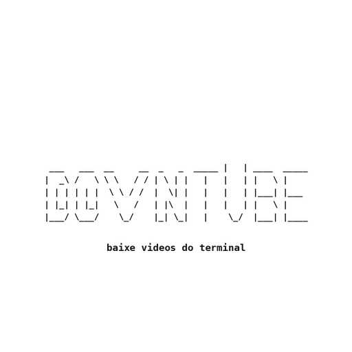

# Downtube

CLI open source (MIT) que baixa vídeos do YouTube e de outros sites
suportados pelo yt-dlp, direto do terminal, com interface de tela cheia
em português (pt-BR).



## Instalação

```bash
npm i -g downtube
```

Ou sem instalar, com npx:

```bash
npx downtube <url>
```

Requisitos: Node.js 18 ou superior. O `yt-dlp` é baixado sozinho na
primeira execução, se não estiver instalado. O `ffmpeg` é usado do PATH;
se não houver, o pacote usa o `ffmpeg-static` como reserva.

## Uso

```bash
downtube <url>              # abre direto no seletor de formato
downtube                    # pede a URL na tela inicial
downtube --theme dark       # tema fixo: auto | light | dark
downtube -h                 # ajuda
downtube -v                 # versão
```

Na tela inicial, cole a URL do vídeo. Se a área de transferência tiver
uma URL válida, o `Tab` cola ela — nada é colado sozinho. Depois o
downtube mostra o título, o canal e a duração, e você escolhe o formato:
uma opção por resolução (até 8, da maior para a menor, em mp4) ou
"áudio apenas · mp3". O download mostra barra de progresso com velocidade
e ETA, indica a mesclagem e a extração de áudio, e salva o arquivo em
`~/Downloads`, com o nome do título sanitizado (no máximo 60 caracteres).

Atalhos:

| Tecla | Ação |
| --- | --- |
| `Tab` | Cola a URL da área de transferência (quando válida) |
| `↑` / `↓` ou `j` / `k` | Escolhe o formato |
| `1`–`9` | Baixa direto o formato daquela posição |
| clique do mouse | Itens da lista, botão `[ baixar ]`, logo (volta ao início) e rodapé (troca o tema) |
| `Enter` | Confirma |
| `Esc` | Cancela a operação atual (no download, apaga os parciais) |
| `Ctrl+T` | Alterna o tema: automático → claro → escuro |
| `Ctrl+C` | Sai |

O histórico das últimas 20 URLs fica em `~/.downtube/history.json`.
O binário do yt-dlp baixado fica em `~/.downtube/bin/yt-dlp`.

## Como funciona

1. **Bootstrap do yt-dlp** — procura o `yt-dlp` no PATH e depois em
   `~/.downtube/bin/`. Se não achar nenhum, baixa o binário standalone
   da última release oficial no GitHub (`yt-dlp_linux`,
   `yt-dlp_linux_aarch64`, `yt-dlp_macos` ou `yt-dlp.exe`), salva com
   `chmod 755` e mostra o status "primeira execução" durante o download.
2. **Probe** — roda `yt-dlp -J --no-playlist` e lê título, canal,
   duração e formatos do JSON. O `Esc` cancela.
3. **Seletor** — monta as opções a partir do JSON do probe: um formato
   mp4 por resolução e a opção de áudio.
4. **Download** — reaproveita o JSON do probe com `--load-info-json`,
   para começar mais rápido. O progresso é lido da saída do yt-dlp
   (velocidade, ETA, fase de merge e de extração de áudio, "parte 1/2"
   quando há dois arquivos). Cancelar com `Esc` apaga os `.part` e
   `.ytdl`.
5. **Tela final** — mostra o caminho do arquivo salvo e o botão
   "baixar outro".

A interface é feita com [Ink](https://github.com/vadimdemedes/ink)
(React para terminal), com
[ink-select-input](https://github.com/vadimdemedes/ink-select-input) e
[ink-spinner](https://github.com/vadimdemedes/ink-spinner), e ocupa a
tela cheia, centralizada — igual ao yoinks. O mouse funciona por
hit-test sobre os frames renderizados: os botões e os itens da lista
são clicáveis, o logo volta para a tela inicial e o rodapé troca o
tema. Ao sair — inclusive em caso de erro — a tela e o cursor são
restaurados (tela alternativa `\x1b[?1049h`) e o erro só é impresso
depois disso. Quando o download termina, o caminho do arquivo também
é impresso no terminal, depois da restauração, para ficar no scrollback.

O downtube não reimplementa extração de sites: todo o trabalho pesado
é do yt-dlp. Não há telemetria.

## Desenvolvimento

```bash
npm install
npm run build      # gera dist/cli.js (com shebang, executável)
npm test           # testes com node:test, via tsx (fixtures, sem baixar vídeo real)
npm run typecheck  # tsc --noEmit
npm run dev        # roda direto do código-fonte com tsx
```

Estrutura:

```text
src/cli.tsx                  ponto de entrada, tela alternativa e erros
src/app.tsx                  máquina de estados das telas
src/theme.ts                 temas auto / light / dark
src/components/             logo, input, picker, progress, panel, footer
src/lib/ytdlp.ts             ensure, probe, buildChoices, download
src/lib/args.ts              flags --theme, -h, -v
src/lib/clipboard.ts         lê a URL da área de transferência
src/lib/history.ts           últimas 20 URLs em ~/.downtube/history.json
src/lib/format.ts            validação de URL, nomes e tamanhos
src/lib/click-map.ts         hit-test do mouse (SGR 1006)
src/lib/use-mouse-click.ts   hook que liga o mouse no Ink
src/lib/platforms.ts         SO, arquitetura e caminhos
test/                        args, format e ytdlp (com fixtures de JSON)
assets/                      logo ASCII em SVG (claro/escuro) e PNG 512 px
docs/lacunas.md              relatório de lacunas (mapeamento da referência)
```

## Roadmap

- [ ] Fila de downloads (várias URLs em sequência)
- [ ] Escolha da pasta de destino e do nome do arquivo
- [ ] Legendas (`.srt`) e miniatura junto com o vídeo
- [ ] Atualização automática do yt-dlp (`downtube --update-yt-dlp`)
- [ ] Playlist com escolha dos vídeos (hoje é `--no-playlist`)
- [ ] Publicação no npm

## Uso responsável

Só se deve baixar conteúdo que se tem direito de guardar, e os termos
das plataformas precisam ser respeitados. O downtube é uma ferramenta
de linha de comando: ele não verifica direitos autorais por você. Use-o
para baixar seus próprios vídeos, conteúdo com licença livre ou material
que a plataforma permite guardar offline.

## Licença

MIT — veja o arquivo [LICENSE](LICENSE).
